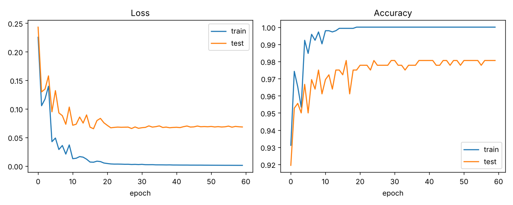

# digit-classifier

A small neural network, **built from scratch with NumPy** (no PyTorch/TensorFlow), that recognises
handwritten digits. It gets about **98% accuracy** on held-out data in a few seconds on a laptop CPU.



## What's inside

- Forward pass, backpropagation and SGD with momentum written by hand (`src/digit_classifier/network.py`)
- A numerical gradient check in the tests, so you can trust the backprop math
- Dataset: scikit-learn's 8x8 digits (1,797 images), bundled with the library, so there is nothing to download

## Quick start

```bash
python -m venv .venv && source .venv/bin/activate
pip install -e ".[dev]"

python -m digit_classifier.train      # trains, saves models/digits_mlp.npz + docs/training_curve.png
python -m digit_classifier.predict    # shows ASCII digits with the model's predictions
pytest                                # run the tests
```

Try different settings: `python -m digit_classifier.train --hidden 128 --lr 0.05 --epochs 100`

## Project structure

```
digit-classifier/
├── .github/workflows/ci.yml     # runs tests on every push/PR
├── docs/training_curve.png      # loss/accuracy plot (generated by training)
├── models/                      # saved weights (git-ignored)
├── src/digit_classifier/
│   ├── data.py                  # loading + preprocessing
│   ├── network.py               # the neural network
│   ├── train.py                 # training loop + plotting
│   └── predict.py               # inference demo
├── tests/test_network.py
├── pyproject.toml, requirements.txt, LICENSE
```

## Ideas for extending it

- Add a second hidden layer or dropout
- Swap in Adam instead of SGD with momentum
- Use the larger MNIST dataset
- Wrap `predict` in a small web app (FastAPI/Streamlit) with a drawing canvas

## License

MIT
